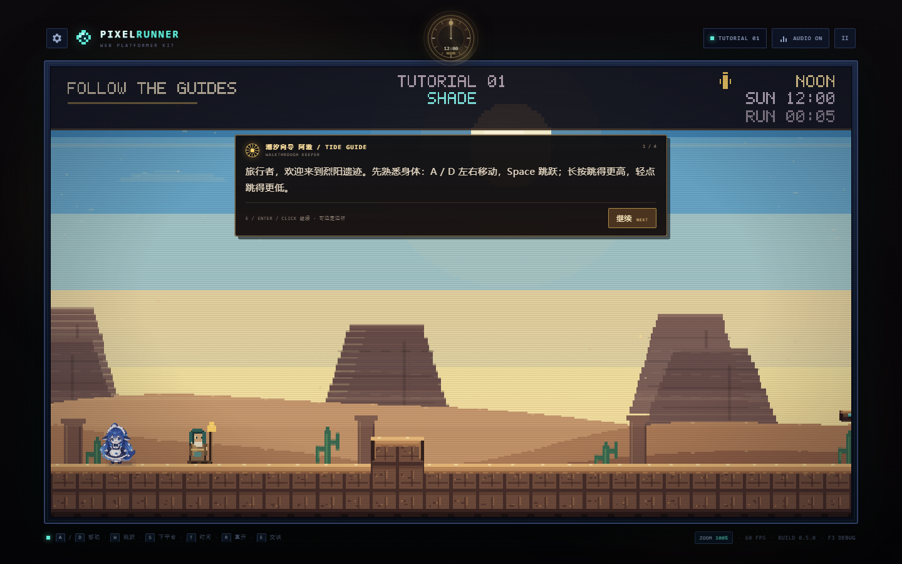
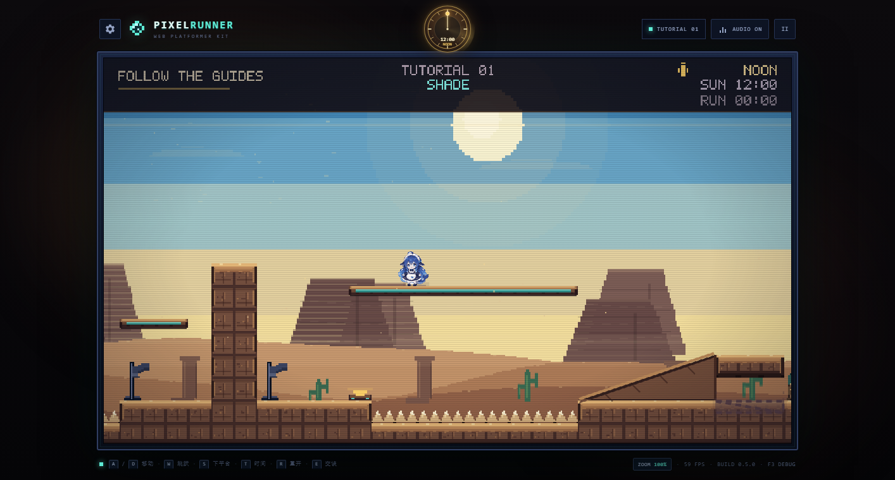
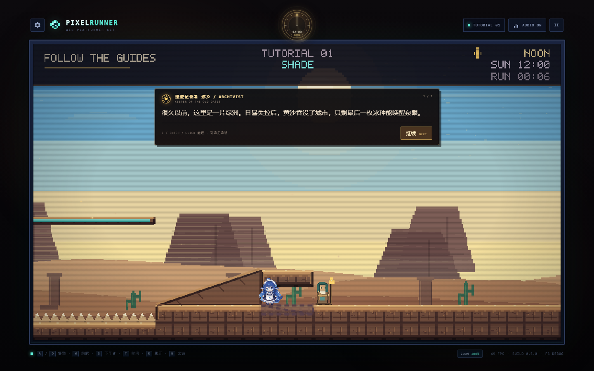
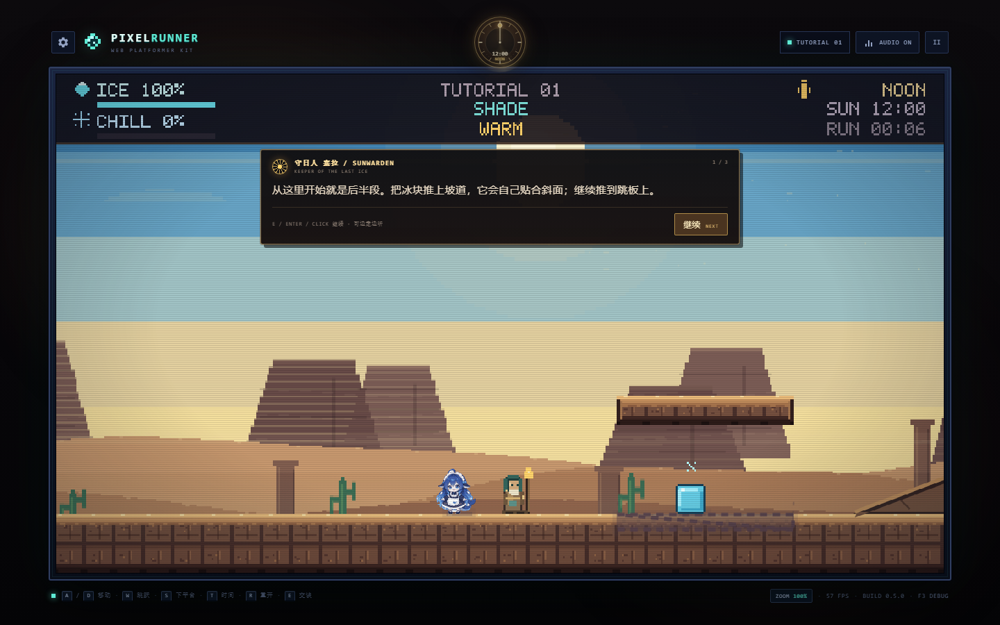
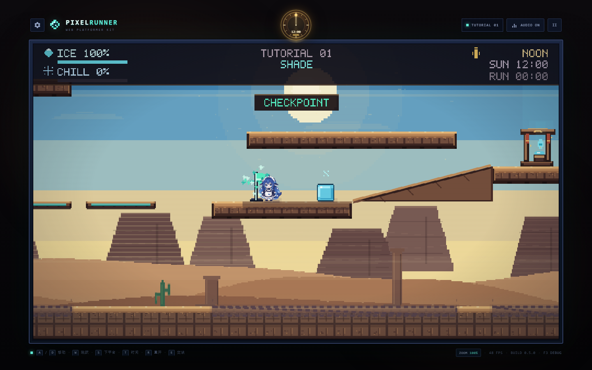
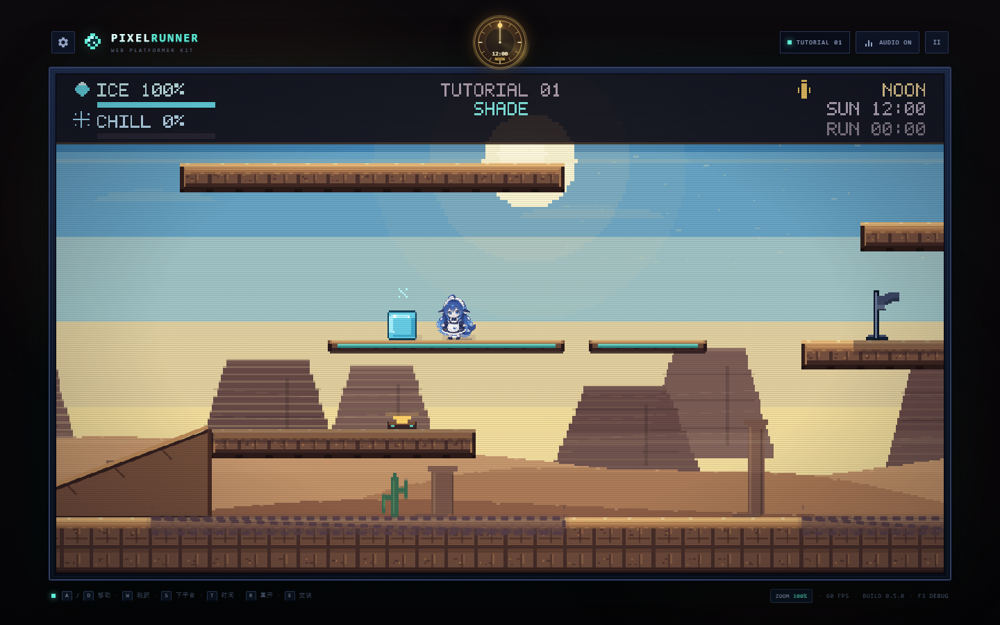
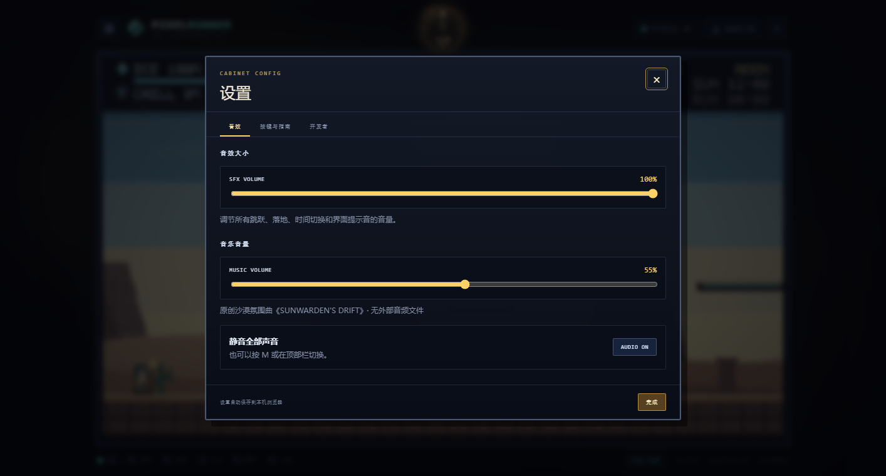
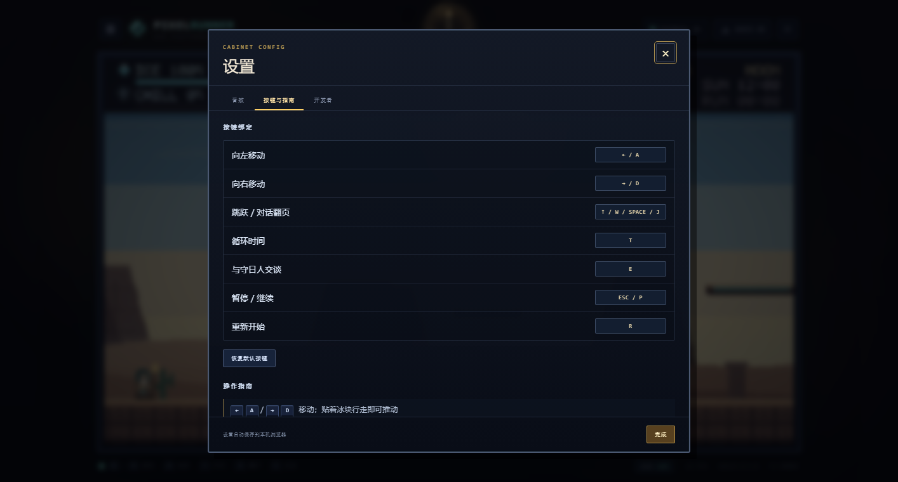
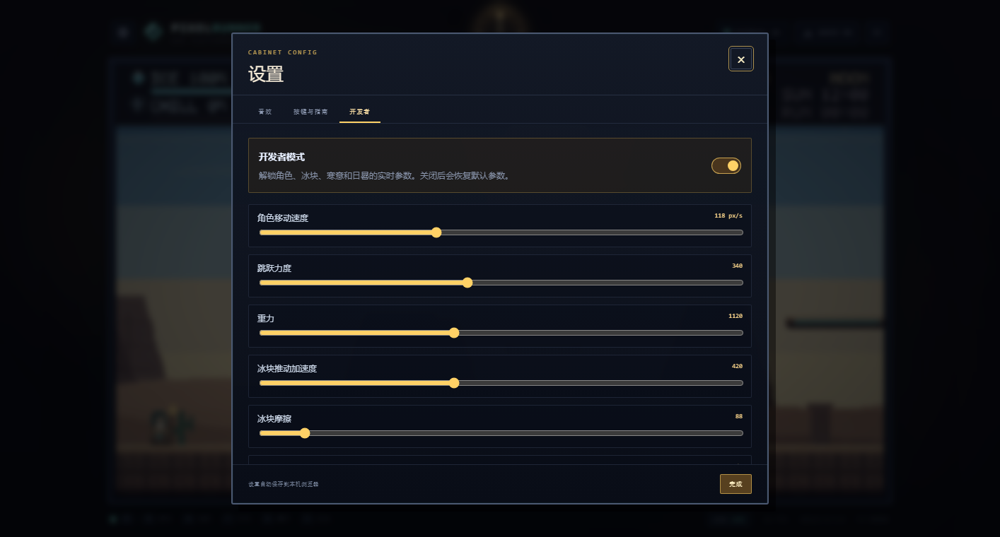
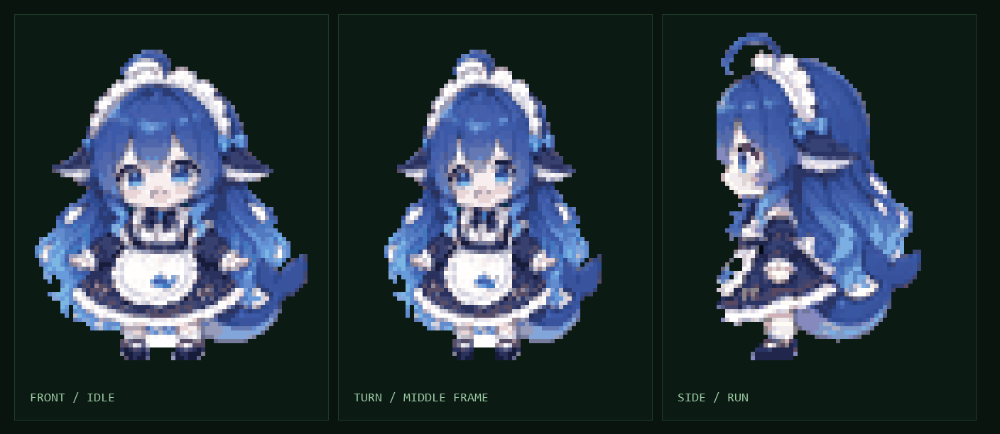

# PIXEL RUNNER

一个**零依赖、纯前端**的像素风 2D 平台跳跃游戏。当前只有一张完整的新手教程关卡 **「SANDS OF THE LAST ICE / TUTORIAL 01」**：前半段由三位 NPC 分别引导操控、机关和背景故事，后半段由守日人引入冰块与冰之祭坛，让玩家把移动平台、跳板、单向踏板、斜坡、时间与运冰组合起来通关。

主角是蓝发鲸鱼女仆。她可以拨动完整的 24 小时日晷，在清晨、正午、黄昏和夜晚之间连续微调时间；白天要利用阴影保护冰块，夜晚冰块停止融化但角色会累积寒意。



## 立即开始

直接双击 `index.html` 即可运行；项目使用传统 `<script>`，零依赖，`file://` 可用。

也可以起一个本地静态服务器：

```bash
python -m http.server 8123
```

然后打开 <http://127.0.0.1:8123/?play=1>。

| URL 参数 | 作用 |
| --- | --- |
| `?play=1` | 跳过标题界面直接开始 |
| `?debug=1` | 打开碰撞箱调试显示（游戏中按 `F3` 也可切换） |

## 操作

| 按键 | 动作 |
| --- | --- |
| `A` / `D` 或 `←` / `→` | 左右移动；贴着冰块行走即可推动 |
| `Space` / `W` / `↑` | 跳跃（短按小跳、土狼时间、跳跃缓冲） |
| `S` / `↓` | 从单向平台向下穿过 |
| `T` | 循环切换清晨 → 正午 → 黄昏 → 夜晚 |
| `1` / `2` / `3` / `4` | 直接切换到清晨 / 正午 / 黄昏 / 夜晚 |
| 点击顶部中央日晷 | 打开 24H CLOCK，拖动太阳/月亮微调时间 |
| 拖动时钟标题 / 右下角 | 移动 / 缩放 24H CLOCK，位置和尺寸自动保存 |
| `E` / 点击 NPC | 与最近的 NPC 对话 |
| `E` / `Enter` / 点击 | 对话中翻页；角色仍可自由移动，离 NPC 太远会自动结束 |
| 左上角齿轮 | 设置：音量、按键绑定、操作指南、开发者模式 |
| `Esc` / `P` | 暂停 / 继续 |
| `R` | 重新开始教程 |
| `M` | 声音开关 |
| `F3` | 显示 / 隐藏碰撞箱 |
| 鼠标滚轮（游戏画面上） | 界面缩放 65%–220% |
| 双击游戏画面 / 点击右下 `ZOOM` | 重置为 100% |

顶部日晷徽章显示精确时刻；点击打开可拖动、可缩放、位置持久化的 **24H CLOCK**。表盘上半圈是白昼，下半圈是夜晚；太阳/月亮、天空色板、阴影和寒意会随连续时间一起插值。触屏设备会自动显示画面下方的触控控制栏。

## 教学关卡结构

地图宽度为 150 格，按从左到右的顺序分成两半：

### 前半段：三段 NPC 引导

| 顺序 | NPC | 位置 | 教学内容 |
| --- | --- | --- | --- |
| 1 | 潮汐向导 阿澈 / TIDE GUIDE | x≈5 | 左右移动、跳跃、重开、暂停、对话操作；前方有一块**实心矮石**，只能跳过去，不能从下面钻过 |
| 2 | 机关师 洛柯 / TINKER | x≈30 | 通过阻挡、尖刺坑和石墙教学移动平台、单向踏板、跳板和斜坡 |
| 3 | 遗迹记录者 弥拉 / ARCHIVIST | x≈72 | 绿洲与最后一枚冰种的背景故事、昼夜规则、日晷操作 |

三位 NPC 都使用 `auto: true`。玩家进入交谈范围后会自动开始对话；对话**不会冻结**物理、计时或时间，角色可以边走边听，走出约 6 格后对话框自动关闭。关闭对话后 NPC 会记住已经引导过，玩家仍可按 `E` 或点击 NPC 再次询问。

机关段不是可选试玩区，路线被改成必须使用机关通过：

1. **横向移动平台**跨过第一段尖刺坑；没有可绕行的地板。
2. **纵向升降台**把角色抬到石墙顶部；石墙高达 6 格，普通跳跃无法越过。
3. **跳板**把角色弹上横跨第二段尖刺坑的**单向长桥**；只能从下方穿过、从上方落脚。站在桥上按 `S` / `↓` 可以主动向下穿过。
4. 桥尽头沿**斜坡**进入背景故事区。

机关段入口及第一、二段障碍后各有一面检查点旗标，掉进尖刺坑会在最近旗标复活，不需要重跑整段教程。





### 后半段：冰种与通关目标

x≈90 的守日人 **塞拉 / SUNWARDEN** 是进入后半段的引导者。她出现时 HUD 才从 `FOLLOW THE GUIDES` 切换为冰块完整度与寒意条，正式引入冰块和通关目标。



后半段的完整路线：

1. 把冰块从阴影顶棚下推到右侧 **第一段斜坡**；冰块会贴合斜面，角色也能跟着爬上去。
2. 继续把冰块推到高台上的 **跳板**。冰块被重物化弹起，穿过上方的 **单向落脚平台**，回落时稳稳落在平台上；跳板平台与落脚桥上方新增了一整排高遮阳物块，正午会在这一带投下阴影。
3. 角色也踩跳板跟上去，把冰块推上 **横向移动平台**，渡到带检查点的高层中段平台。
4. 中段平台上方新增了一整排 **砂岩遮阳梁**，正午会在这里投下长阴影；把冰块从阴影里推上 **第二段斜坡**。
5. 第二段斜坡通向更高的 **冰之祭坛**，把冰块推到顶端完成运送。





完成时冰块必须到达祭坛；玩家单独到达只会得到提示。完整度越高、用时越短越好，最佳成绩会保存在本机浏览器。

## 时段、阴影与寒意

| 时段 | 表盘时间 | 太阳/月亮 | 长影方向 | 阳光 | 寒意 |
| --- | --- | --- | --- | --- | --- |
| 清晨 `DAWN` | 06:00 | 左侧低空 | 向右拉长 | 较弱 | 阳光下下降 |
| 正午 `NOON` | 12:00 | 接近头顶 | 短而垂直 | 最强 | 阳光下下降 |
| 黄昏 `DUSK` | 18:00 | 右侧低空 | 向左拉长 | 较弱 | 阳光下下降 |
| 夜晚 `NIGHT` | 00:00 | 月亮 | 无直射阴影 | 无 | 快速累积 |

时间是一个连续值：`timeValue` 从 0（06:00）平滑变化到 4（次日 06:00）。拖动日晷、按 `T` 或按 `1/2/3/4` 都操作同一条时间轴。白天阳光会融化冰块；夜晚没有直射阳光，冰块停止融化，但角色会累积寒意。寒意满 100% 会失败；站到白昼直射阳光下可以回暖。

阴影判定使用从受光点指向太阳的多点射线，并分别采样地面投影、悬空物块顶面以及离开关卡边界的开放天空，避免两块阴影交叠时因中心点漏光而误判。

## 设置菜单

左上角齿轮打开设置，自动保存并从标题、暂停和失败界面直接打开；打开期间游戏逻辑、计时、时间与寒意全部冻结。

- **音效与音乐**：音效、音乐各自独立的 0–100% 滑杆；顶部 M 同时静音全部声音。音乐是 WebAudio 实时合成的原创沙漠氛围曲《SUNWARDEN'S DRIFT》，无外部音频文件。全局输出上限为原值的 3 倍，总线末端有限幅器防止硬削波。
- **按键与指南**：重新绑定向左、向右、跳跃、循环时间、交谈、暂停和重开；支持恢复默认、冲突提示，操作指南会跟随绑定实时更新。
- **开发者**：实时调节角色速度、跳跃力度、重力、冰块推动/摩擦/最大速度、融化倍率、夜晚寒意、阳光回暖和时段切换速度。







## 角色

角色像素精灵由参考三视图的正面与侧面姿势离线像素化而来，保留蓝发长刘海、白色蕾丝女仆头饰、鲸耳鳍、蓝色蝴蝶结、白围裙上的小鲸鱼纹样、深蓝连衣裙与鲸尾。待机时使用正面，移动时切换到侧面；转身会插入短暂正面帧并配合轻微横向压缩，避免瞬间翻转。



## 项目结构

```text
index.html            页面与界面结构
css/style.css         街机柜外观、响应式布局、覆盖层、触屏控制
js/core.js            常量、输入、AABB 碰撞、5x7 像素字体、颜色插值
js/character-art.js   内嵌的正面 / 侧面角色像素精灵
js/levels.js          新手教程地图、NPC 对话与机关数据、解析器
js/entities.js        玩家、冰块、移动平台、跳板、NPC、祭坛、粒子等
js/audio.js           WebAudio 音效与原创程序化配乐
js/game.js            游戏状态、物理、时间/阴影、相机、渲染、HUD、教学触发
js/main.js            启动流程、对话/覆盖层、设置、按键/触屏、画布适配、主循环
assets/               角色精灵 PNG 源文件
tests/                Node 单元测试、共享测试夹具、无浏览器渲染冒烟测试
```

## 编辑教程地图

地图在 `js/levels.js` 的 `LEVEL_TUTORIAL.rows` 中，每个字符代表一个 16×16 瓦片：

| 符号 | 含义 |
| --- | --- |
| `#` | 实心砂岩 / 遗迹 |
| `^` | 尖刺（危险） |
| `o` | 霜晶（当前教程未使用） |
| `S` | 巡逻史莱姆（当前教程未使用） |
| `C` | 检查点旗标（机关段 3 面 + 最终路线 1 面） |
| `I` | 可推动冰块（必须有且只有一个） |
| `N` | 教学 NPC；按从左到右的顺序匹配 `dialogues` |
| `P` | 出生点（必须有且只有一个） |
| `G` | 终点祭坛（必须有且只有一个） |
| `.` | 空气 |

所有行必须等宽。`N` 的顺序决定它使用 `dialogues` 数组中的哪一段文本；每个对话项可设置 `name`、`role`、`auto` 和 `lines`，其中 `{controls}` 会被实时按键摘要替换。

机关不是 ASCII 字符，而是在 `platforms` / `jumpPads` / `slopes` 数组中配置：

```js
platforms: [
  { tx: 36, ty: 13, w: 4, axis: 'x', range: 48, speed: 0.8 },
  { tx: 44, ty: 11, w: 3, axis: 'y', range: 32, speed: 0.9 }
],
jumpPads: [{ tx: 53, ty: 14, power: 500 }],
slopes:   [{ tx: 60, ty: 14, w: 6, h: 2 }]
```

`axis` 支持 `x` / `y`；`range` 是相对基准位置的半程像素距离；`slopes` 的 `w` / `h` 以瓦片为单位，`dir: 'down'` 会生成右侧下降的反向斜坡。平台使用 6px 薄碰撞体，是单向的；从下方可以穿过。

## 调整手感与难度

- 默认参数：`js/core.js` 的 `PJ.DEFAULT_TUNING`；运行时参数在 `PJ.TUNING`
- 移动加速度、空中控制和转头手感：`js/entities.js` 顶部 `PHYSICS`
- 冰块推动与玩家交互：`js/game.js` 的 `_updateIceInteraction()`
- 融化速度：`_updateIceSun()` 的 `meltRate`
- 寒意：`_updateChill()` 的 `nightChill` / `sunWarmth`
- 时段过渡：`_updateTime()` 的 `timeEase`
- 相机：`_updateCamera()`

## 测试

```bash
node tests/run-all.js
```

覆盖 38 项测试：

- 单张教程地图的尺寸、符号、出生点/冰块/祭坛/NPC 落脚点
- 前半段三个教学 NPC 的顺序与对话，后半段冰种/祭坛顺序
- 实心矮石、尖刺坑、6 格石墙、跳板长桥与检查点布置
- 两段最终斜坡、跳板、单向落脚平台、横向渡台与高层祭坛的几何连接
- 后半段跳板平台/落脚桥与中段的高遮阳物块、检查点与高点通关判定
- 跳板在未按住跳跃键时仍保持完整弹射高度
- `S` / `↓` 从单向平台向下穿过，且有防立刻重新落回平台的短暂冷却
- 左右墙、天花板、地板碰撞与高速防穿墙
- 跳跃高度、短按小跳、跑墙停止、坡台接壤
- 相机连续移动与反向时的单步位移上限
- 转身延迟、朝向翻转事件与正面/侧面混合回退
- 冰块落地、推动加速度、松手惯性、摩擦停止与斜坡倾斜
- 角色/冰块在机关上的承载、跳板冲击与头部碰撞
- NPC 自动对话、自由移动、离开自动结束、重复交谈与角色/机关交互
- 按键映射、开发者参数、音乐/音效独立音量与 3 倍输出
- 清晨/正午/黄昏阴影、夜晚寒意与多点日照采样
- 24 小时日晷连续时间与精确分钟映射
- 无浏览器 Canvas 的完整模拟 + 渲染冒烟测试

## 可以继续扩展

- 更多关卡与关卡选择
- 新的推动/堆叠冰块谜题
- 敌人与 Boss
- 更多 NPC 路线和支线
- 手柄支持
- 简易地图编辑器

## 说明

- 项目不依赖 npm 包、构建工具或服务器端；所有位置均可离线运行。
- 角色精灵以 data URL 内嵌，避免 `file://` 下的图片加载限制。
- 音乐、音效、阴影和光线均为运行时生成，没有外部音频或贴图依赖。
